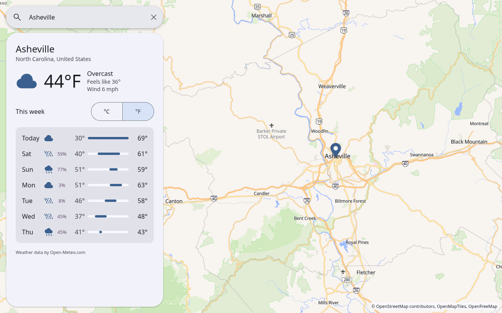
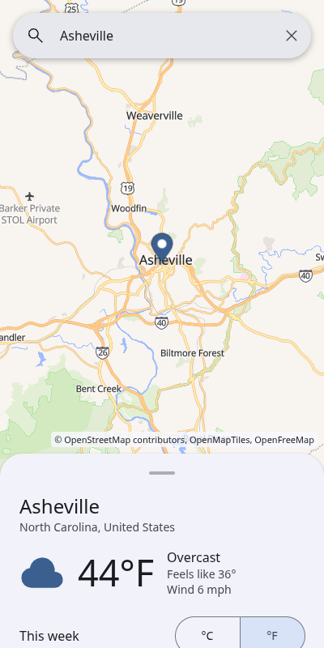

# capacitor-weather

A weather app in Vue with Google's Material Web components, wrapped for
Android and iOS with Capacitor. One screen: a map with a Material 3 search
bar over it. Search for a place, or press and hold on the map, and the
forecast for the week appears.

**Live demo:** <https://calemccammon.github.io/capacitor-weather/>

| Wide window                                                                                                 | Phone                                                                                         |
| ----------------------------------------------------------------------------------------------------------- | --------------------------------------------------------------------------------------------- |
|  |  |

It is one of six cross-platform builds of the same app, written to compare
the frameworks. The others are
[flutter-weather](https://github.com/calemccammon/flutter-weather),
[kmp-weather](https://github.com/calemccammon/kmp-weather),
[react-native-weather](https://github.com/calemccammon/react-native-weather),
[maui-weather](https://github.com/calemccammon/maui-weather) and
[ionic-weather](https://github.com/calemccammon/ionic-weather).
[android-weather](https://github.com/calemccammon/android-weather) is the
native Android build in Kotlin and Jetpack Compose, which goes further with
saved places, offline forecasts and a home-screen widget.

ionic-weather uses Capacitor too, with Ionic's components and Angular. This
build is Capacitor without Ionic: the web app is plain Vue, and its look is
entirely its own.

## What it does

- **Search as you type**, debounced; a late response to an older query never
  overwrites a newer one.
- **Pick a point** by pressing and holding on the map.
- **Forecast**: current conditions, then seven days with the chance of
  precipitation and a bar placing each day's low and high within the week's
  range.
- **Adapts to the window**: a bottom sheet on a phone, a side panel from
  840 px wide. The map keeps the chosen place clear of both.
- **Celsius or Fahrenheit**, switched from the forecast and saved between
  launches. The default follows the device's region.
- **Light and dark** themes from one seed colour, following the system. The
  map changes style with them.
- **Accessible**: screen readers read each forecast block as one sentence,
  loading and errors are announced, and the forecast's columns widen with the
  user's text size.
- **Errors**: a timeout, no connection, a refused request and an
  overloaded service each get their own message and a Try again button.

## Architecture

Clean Architecture in three layers. Dependencies point inward only: `data`
and `ui` import `domain`, and `domain` imports neither, nor any library.
`npm run lint` fails on an import that breaks this (the rules are in
`eslint.config.ts`).

| Path          | What it holds                                                                                                                                                                                                                                                                                              |
| ------------- | ---------------------------------------------------------------------------------------------------------------------------------------------------------------------------------------------------------------------------------------------------------------------------------------------------------- |
| `src/domain`  | The app's own types (`Place`, `Forecast`, `WeatherCondition`, `Units`), the repository interfaces (`WeatherRepository` with its failure kinds, `SettingsRepository`), and the use cases (`SearchPlaces`, `GetForecast`, `GetUnits`, `SetUnits`) that hold the rules. Plain TypeScript: no Vue, no Capacitor.  |
| `src/data`    | Open-Meteo: the wire-shaped models (`*Dto.ts`), their translation into domain types, and the repository implementation. Settings are kept with Capacitor's Preferences plugin.                                                                                                                              |
| `src/l10n`    | All user-facing strings, screen-reader text included, in `en.json`, read through `vue-i18n`. The keys are typed, so a misspelt one fails `npm run type-check`.                                                                                                                                                               |
| `src/ui`      | `core` has the theme, the icons and the mapping from domain values to wording and icons. `home` has `models` (what the screen shows, already worded and rounded), `stores` (Pinia stores that call use cases and produce those models) and `components` (render the models and never import the domain or data). |
| `src/di`      | `provideDependencies` builds the use cases over whichever repositories it is given and provides them to the app. Nothing imports from here but `main.ts` and the tests' set-up.                                                                                                                             |
| `src/testing` | Fakes shared by the tests, which sit beside the code they test in `__tests__` folders.                                                                                                                                                                                                                      |

Each layer has its own model, with a mapping between them:

|              | Data                           | Domain       | UI                                                                  |
| ------------ | ------------------------------ | ------------ | ------------------------------------------------------------------- |
| Type         | `ForecastDto`                  | `Forecast`   | `ForecastUiModel`                                                   |
| A day's high | `temperature_2m_max[1] = 64.3` | `high: 64.3` | `high: "64°"`, `barEnd: 0.75`                                       |
| Conditions   | `weather_code: 3`              | `'overcast'` | an icon name and `"Overcast"`                                       |
| A failure    | HTTP 400, a timeout            | `'rejected'` | `t('failure.rejected')`: "The weather service refused the request." |

State is held by two Pinia stores, `useHomeStore` and `useSearchStore`, which
take the place of the other builds' view models. Each exposes one piece of
state, so it can be tested without rendering. Components take the state as
props and report user actions as events.

The buttons, list, progress bars and units choice are
[Material Web](https://material-web.dev/)'s. It has no search bar and no
bottom sheet, so `PlaceSearchBar` and `BottomSheet` are the app's own, drawn
with Material 3's tokens.

The domain, data and wording code is close to
[react-native-weather](https://github.com/calemccammon/react-native-weather)'s,
which is TypeScript too.

## Running

Vue 3, Vite 8, Capacitor 8, Node 24. Targets: web, Android and iOS.

```sh
npm install
npm run dev             # the app in a browser, rebuilding on change
npm run build           # type-checks, then builds the static site in dist/
npm run build:android   # builds the site, copies it into android/ and builds a debug APK
```

The Android project in `android/` is generated by Capacitor and committed,
as Capacitor recommends. To run the APK, start the emulator with
`emulator -avd Pixel_API_36` and install
`android/app/build/outputs/apk/debug/app-debug.apk` with `adb install`, or
open `android/` in Android Studio. There is no `ios/` project yet: adding
and building one needs a Mac.

## Checks

```sh
npm run lint           # oxlint and ESLint; `npm run lint:fix` fixes
npm run format:check   # Prettier; `npm run format` fixes
npm run type-check
npm run test:unit      # Vitest: domain, data, wording, UI models and stores
npm run test:e2e       # Playwright: the whole screen in a browser, at phone and wide sizes
```

The browser tests stub the weather service and the map style, so they need
no network. Run `npx playwright install chromium` once first.

`.github/workflows/ci.yml` runs these on pushes to `main` and on pull
requests, then builds the web app. On `main`, and on demand from the Actions
tab, it also builds an Android debug APK. Both builds are uploaded as
workflow artifacts.

`.github/workflows/pages.yml` builds the web app and publishes the live
demo. It runs only when started by hand from the Actions tab.

## Data and credits

- Place search and forecasts: [Open-Meteo](https://open-meteo.com/) (no key;
  free for non-commercial use; CC BY 4.0).
- Map: [OpenFreeMap](https://openfreemap.org/) styles and tiles (no key),
  from [OpenMapTiles](https://openmaptiles.org/) and
  © [OpenStreetMap](https://www.openstreetmap.org/copyright) contributors,
  drawn with [MapLibre GL JS](https://maplibre.org/).
- Icons: Google's [Material Symbols](https://fonts.google.com/icons)
  (Apache License 2.0).

## Known limits

- **English only.** All strings are in `src/l10n/en.json` and weekday names
  follow the app's locale, so adding a language means adding one file.
- **Places are not saved**: the chosen place is forgotten when the app
  closes. Only the choice of units is kept.
- **The bottom sheet drags by its handle only**, between two stops.
  Scrolling its content does not pull the sheet up.
- **Android and the web only so far.** iOS needs a Mac.
- **Material Web is in maintenance**: Google still publishes it but is not
  adding to it, and its segmented buttons are from its "labs" folder.

## Not built

Ideas that were considered and left out, roughly in the order they would be
worth doing:

- **Saved places** shown when the app opens.
- **Forecast for the current location**, which needs the location permission
  on each platform.
- **A second language**, to exercise the localisation set-up.
